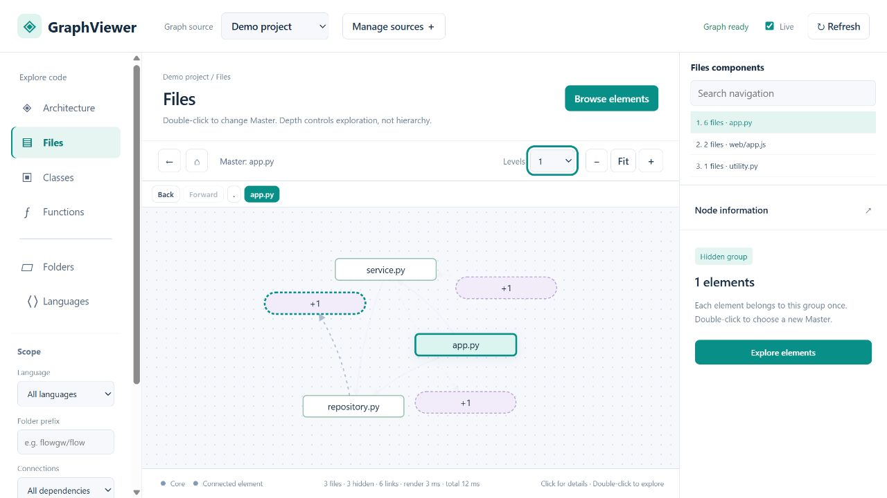

# Code Review Graph Viewer

A local, live graph explorer for [Code Review Graph](https://github.com/tirth8205/code-review-graph).
Navigate real code dependencies without repeatedly generating a static HTML export.

**Independent community companion, not an official Code Review Graph project.**
Code Review Graph builds and updates the index; this application reads it without modifying it.



[View the screenshot gallery](docs/screenshots/README.md) — files, hidden groups, class and method navigation, source viewing and connection setup.

## Quick start

Requires Python 3.12+ and [uv](https://docs.astral.sh/uv/).

```sh
git clone https://github.com/FabioSantini/code-review-graph-viewer.git
cd code-review-graph-viewer
uv sync
uv run code-review-graph-viewer --demo
```

Open **http://127.0.0.1:8120/**. The demo contains only synthetic code, generated locally.
No AI model, API key, paid subscription or external service is needed to navigate a local index.

To explore your own project, build its index using Code Review Graph first (see the
[upstream installation and build instructions](https://github.com/tirth8205/code-review-graph#quick-start)), then run:

```sh
uv run code-review-graph-viewer --repo /path/to/your-project
```

Windows PowerShell example:

```powershell
uv run code-review-graph-viewer --repo 'C:\projects\my-project'
```

Or launch without arguments and use **Manage sources → Add a source → Local graph index**.
Set the SQLite database path and repository root. Multiple named sources are supported.
For a nonstandard database location, use this form and set both paths explicitly.

## Navigation

- **Files, Classes, Functions:** select a connected component in the upper right panel.
- **Folders:** use the directory tree; edges aggregate dependencies of files directly in each folder.
- **Languages:** see all indexed languages, including isolated ones, with file and symbol counts.
- **Architecture:** browse directory-derived areas (first two path components), not inferred service boundaries.
- Click a node for details; double-click to make it the navigation reference (**Master**).
- Set **Levels 1–10** to control exploration depth in both directions. Levels do not impose a parent/child layout.
- Purple number nodes summarize **disjoint connected groups of hidden elements**. Each hidden element is counted once.
  Double-click a group to browse and search its members. Dashed directed edges preserve its relationships to visible nodes.
- Drag any node, including a number node. Zoom or pan the canvas; **Fit** frames the visible graph.
- The browser remembers the source, category, Master, depth, filters, viewport, moved nodes and Master history.
  Back/Forward preserve the current history cursor across reopening. State is local to the browser and URL origin.
- **Open** displays local source code, or the indexed line range of a class/function, in a read-only viewer.
- In **Classes**, **Alt + double-click** opens the class's methods in a dedicated window.
  Choose a method to explore its relationships with methods of other classes, with separate depth and history.
  Closing this window leaves the main canvas unchanged.

## Live updates

The **Live** toggle polls a small SQLite/database-WAL revision signature every three seconds.
When Code Review Graph updates the index, the visible graph is reloaded automatically while preserving
its reference, viewport and saved node positions. Polling pauses while the tab is hidden,
a dialog is open or a node is being dragged. Refresh remains available manually.

This viewer **does not index or watch source files itself**. Keep Code Review Graph's hooks/watch mode
running to update its database. A source-code edit becomes a graph update only after the index is updated.

## Local configuration

Connections are stored in `.local/sources.json` under the current working directory.
Set `GRAPHVIEWER_DATA_DIR` to move this directory. Optional `projects.json` maps display names to
existing database paths; see `projects.example.json`. Relative paths resolve against that JSON file.
`GRAPHVIEWER_PROJECTS_FILE` selects another configuration. Missing databases are never created by normal navigation.

Use `--port 8121` (or `GRAPHVIEWER_PORT`) to select another port.

## Compatibility and limits

- Validated against **Code Review Graph 2.3.9** SQLite `nodes` and `edges` tables; synthetic fixtures are covered by tests.
  The upstream schema is not a stable public viewer API: future changes may require an adapter.
- Complete component/dependency browsing requires a **local CRG SQLite index**.
  MCP stdio and Streamable HTTP connection tools are included, but a partial remote MCP catalog is not presented as a complete graph.
- File dependencies aggregate indexed cross-file calls, imports and references; class dependencies include members and inheritance.
  Standalone functions and class methods are separate projections. Unresolved calls are excluded by default.
- Only recorded edges are shown. HTTP/WebSocket connections, dynamic imports and runtime behavior may be absent.
- Large depths can expose many nodes; use fewer levels for a focused view. Layout is computed locally in the browser.
- Source line ranges come from the index. Rebuild/update a stale index if symbol excerpts no longer align.
- Session state is for the main canvas. The method window has independent navigation during the current session.

## Privacy and deployment

Runs on **127.0.0.1**, reads graph SQLite with `mode=ro` and `PRAGMA query_only=ON`, and does not
upload your code or database. Source viewing is restricted to indexed files within the configured repository root.
There is no telemetry, external font/CDN or external AI request in local-index navigation.

This is a trusted single-user local tool, not an authenticated multi-tenant web service.
Do not expose it directly to the internet. MCP commands execute locally when explicitly connected;
only add configurations you trust. Databases, local connections, logs and personal configuration are git-ignored.

## Development

```sh
uv sync --dev
uv run pytest -q
npm test
uv build
```

Node.js 20+ is needed for frontend tests only. There is no frontend build step.
CI runs backend and frontend tests on Linux and Windows, including packaging checks.

Issues and contributions are welcome. Please use synthetic reproductions; do not upload proprietary code or databases.
See [CONTRIBUTING.md](CONTRIBUTING.md).

## Acknowledgements

[Code Review Graph by Tirth](https://github.com/tirth8205/code-review-graph) provides the graph index and MCP integration.
This project offers an alternative navigation interface and is independently maintained.

MIT licensed. See [LICENSE](LICENSE).
