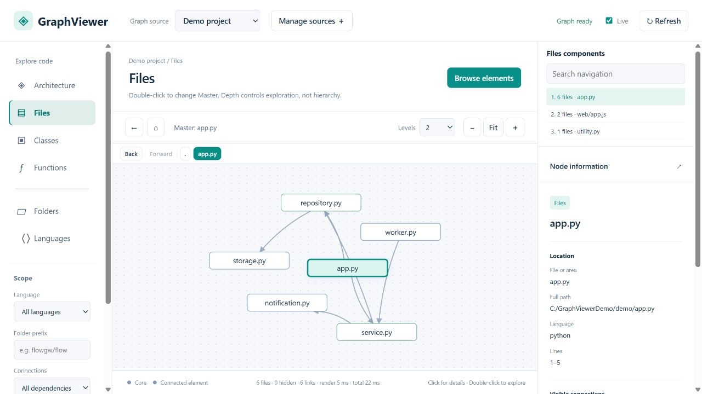
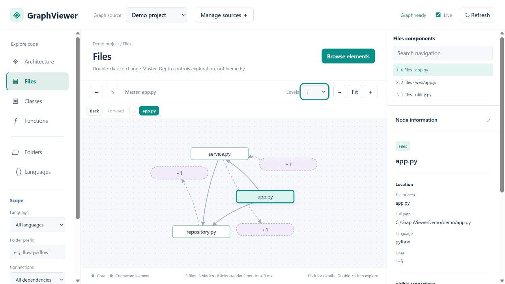
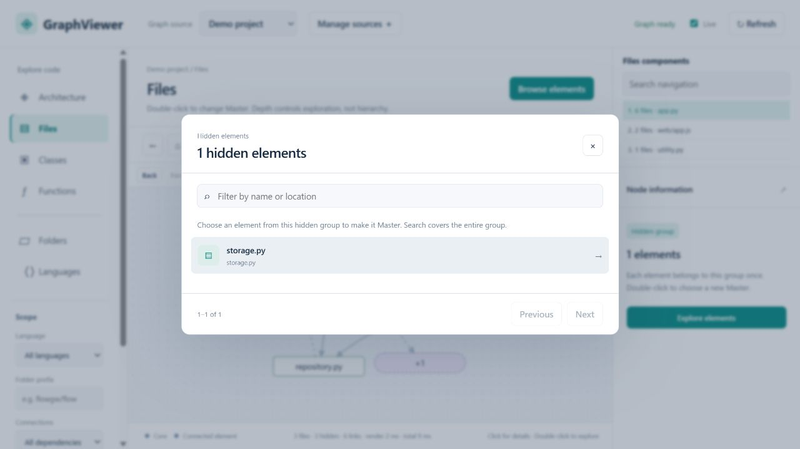
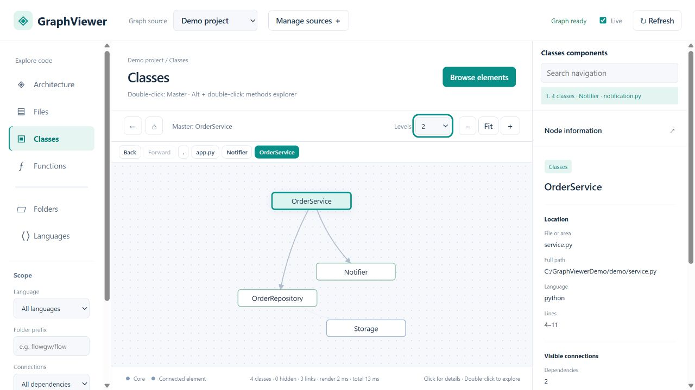
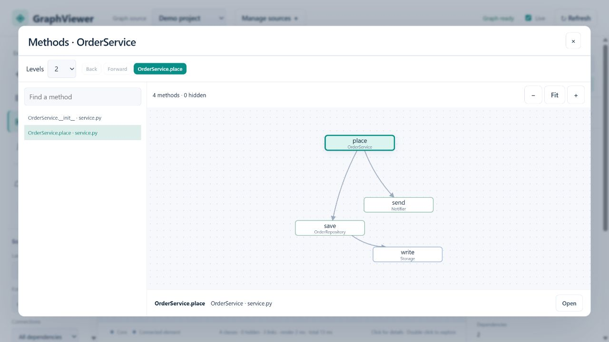
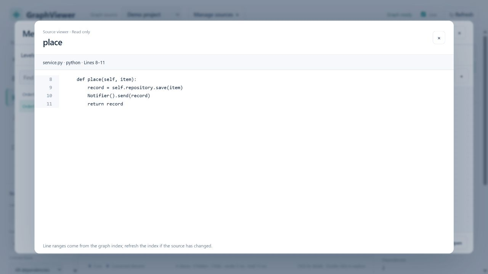
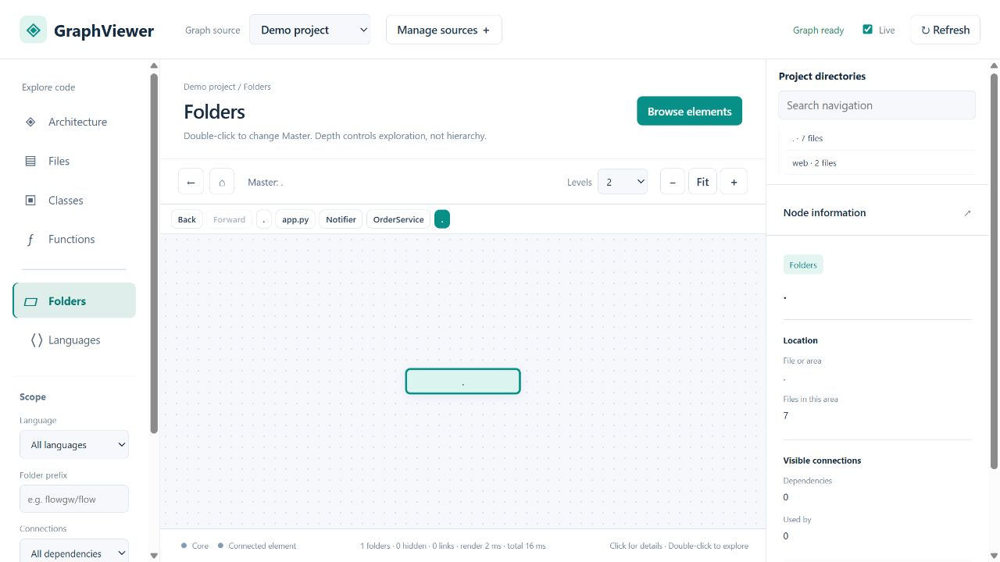
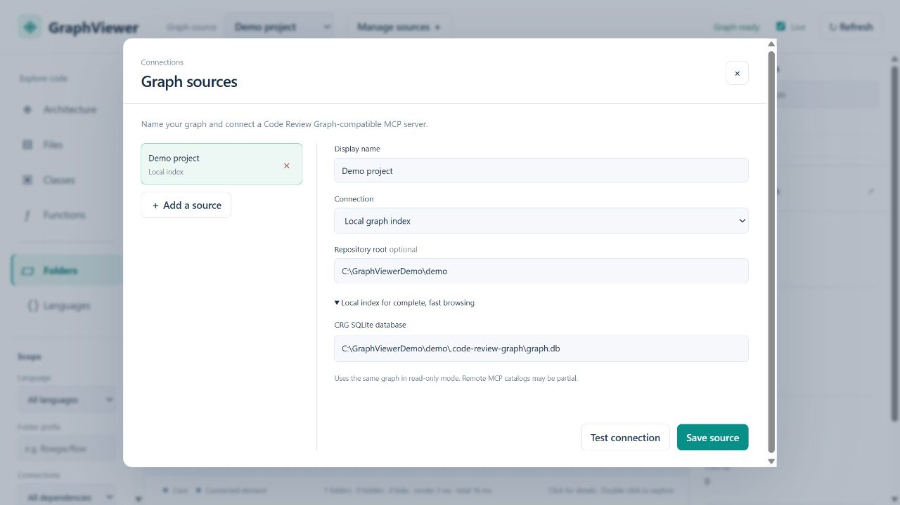

# Screenshot gallery

Real screenshots of Code Review Graph Viewer running locally with its synthetic demo.
All code, names and paths shown belong to the example project; no private project data is included.
PNG images are 1280 × 720 pixels, without browser chrome.

## 1. File dependencies

Explore incoming and outgoing file dependencies on a free-form graph. Select a node for its location and metadata; use the component list to switch to another connected group.

## 2. Exploration depth and hidden groups

Reduce the depth to keep only direct neighbors. Purple summary nodes represent disjoint groups of hidden elements; their directed boundary edges remain visible.

## 3. Navigate inside a hidden group

Double-click a purple node to search and browse its members, then choose an element as the new navigation reference. The example below contains one hidden file.

## 4. Class relationships

Class-level edges aggregate the indexed relationships of the class and its members. The navigation reference is highlighted; it is not a parent in a hierarchy.

## 5. Dedicated method explorer

Alt + double-click opens a class's methods without replacing the main canvas. Choosing `OrderService.place` reveals calls to methods of `OrderRepository`, `Notifier` and `Storage`. The window has its own depth and history controls.

## 6. Source code viewer

Open the selected file, class or method in a read-only source viewer. Symbol excerpts retain the original line numbers recorded by the index.

## 7. Directory navigation

The upper right panel becomes a directory tree in the Folders view. This small demo has two independent directory groups, so the selected root folder has no cross-directory edges.

## 8. Connect a local index

Add named project sources and configure a local Code Review Graph SQLite database and repository root. The database remains local and is read in read-only mode.

These images may be reused when describing this MIT-licensed project. Link back to
[Code Review Graph Viewer](https://github.com/FabioSantini/code-review-graph-viewer)
and credit [Code Review Graph](https://github.com/tirth8205/code-review-graph) as the indexing tool.
